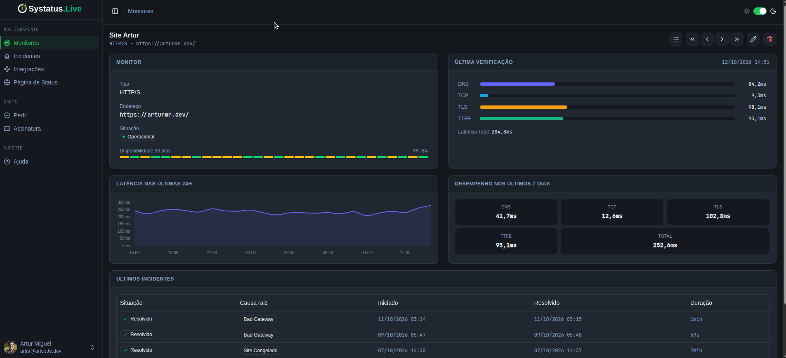
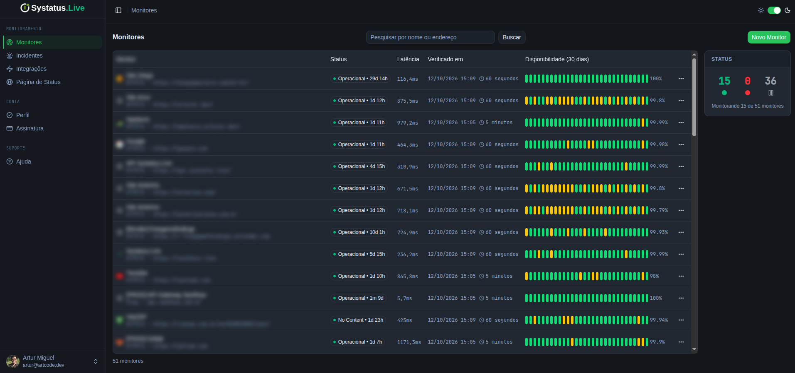
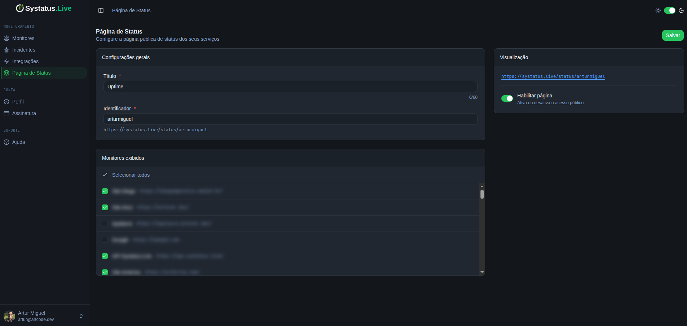
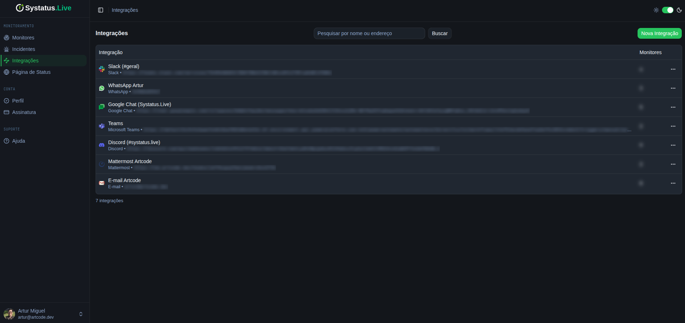
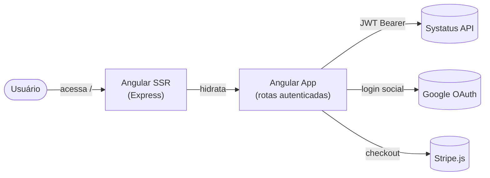

<p align="center">
  
</p>

<h1 align="center">Systatus</h1>

<p align="center">
  <strong>Descubra falhas antes dos seus clientes.</strong>
</p>

<p align="center">
  Painel web de monitoramento de disponibilidade do Systatus, com gestão de monitores,<br/>
  acompanhamento de incidentes e configuração de alertas em múltiplos canais.
</p>

<p align="center">
  <a href="LICENSE"></a>
  
  
</p>

---

> [!IMPORTANT]
> O produto **[systatus.live](https://systatus.live)** foi descontinuado. O código-fonte está disponível sob a licença Apache 2.0 para estudo, adaptação e desenvolvimento de novos projetos pela comunidade.

Este repositório contém o **painel web do Systatus**. A lógica de negócio, a persistência de dados e as verificações periódicas de disponibilidade são implementadas na API: [systatus-live/systatus-live-backend](https://github.com/systatus-live/systatus-live-backend).

## Demonstração

<p align="center">
  
</p>

<p align="center">
  
  
  
</p>

## Funcionalidades

- Página de apresentação pré-renderizada durante o build para SEO, com geração automática de sitemap.
- Cadastro e login por e-mail/senha ou Google OAuth, com verificação em 2 etapas (OTP) e recuperação de senha.
- Criação e gerenciamento de monitores, consulta ao histórico de incidentes e configuração de integrações: Slack, Discord, Google Chat, Mattermost, Microsoft Teams, e-mail e WhatsApp.
- Página pública de status identificada por slug (`/status/:slug`), acessível sem autenticação.
- Gráficos de disponibilidade e latência com Chart.js.
- Permissões de plano (`STATUS_PAGE`, `CUSTOM_NOTIFICATION`) via `ngx-permissions`, aplicadas nas rotas do painel.
- Gerenciamento de assinatura na área de conta, com integração ao Stripe e checkout processado pela API.
- Design system baseado em Spartan NG Brain e Tailwind, com componentes adicionados via CLI.

## Tecnologias e arquitetura



| Camada | Tecnologia | Papel no projeto |
| --- | --- | --- |
| Framework | Angular 21 (standalone + SSR) · TypeScript 5.9 | Roteamento com lazy loading, hydration, renderização híbrida |
| Estilo | Tailwind CSS 4 · Spartan NG Brain | Design system e componentes headless |
| Estado | Angular Signals | Sessão reativa e controle de acesso por plano |
| Gráficos | Chart.js | Uptime e latência dos monitores |
| Servidor SSR | Express 5 | Serve o build SSR em produção |
| Infraestrutura | Docker (multi-stage) · GitLab CI/CD | Build e deploy |

## Execução local

Requisitos: Node.js 24 ou superior e uma instância da [API do Systatus](https://github.com/systatus-live/systatus-live-backend) em execução, localmente ou em um servidor remoto.

```bash
git clone https://github.com/systatus-live/systatus-live-frontend.git
cd systatus-live-frontend
npm install
npm start
```

O painel fica disponível em `http://localhost:4200`. Por padrão, a URL da API é `http://localhost:4000`, definida em `src/environments/environment.ts`.

<details>
<summary>Configuração de ambiente</summary>

As configurações de ambiente são definidas nos arquivos de `src/environments/`, com substituição pelo mecanismo `fileReplacements` do Angular CLI:

```typescript
export const environment = {
  apiUrl: "",              // URL base da API REST
  webUrl: "",              // URL base do painel web
  googleOAuthClientId: "", // Client ID do Google OAuth 2.0
  stripePublishableKey: "" // Chave publicável do Stripe
};
```

| Arquivo | Usado em |
| --- | --- |
| `environment.ts` | `npm start` (desenvolvimento) |
| `environment.prod.ts` | `ng build --configuration production` |

Essas configurações são disponibilizadas ao navegador e incluem valores públicos, como o client ID do Google OAuth e a chave publicável do Stripe. Credenciais privadas devem permanecer no backend.

</details>

## Docker

```bash
docker compose up -d --build
```

O comando inicia o painel na porta `4002`, conforme definido em [docker-compose.yml](docker-compose.yml), utilizando o build multi-stage de [Dockerfile.prod](Dockerfile.prod). A aplicação utiliza SSR via Express e é executada com um usuário sem privilégios de root.

## Licença

Este projeto está licenciado sob a [Apache 2.0](LICENSE).
